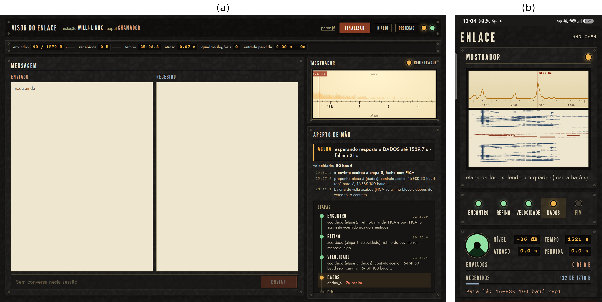
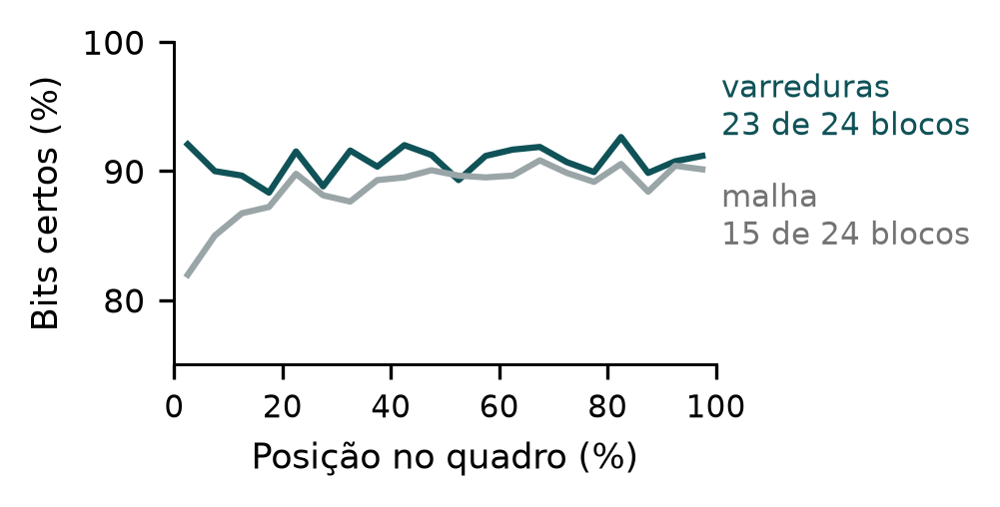
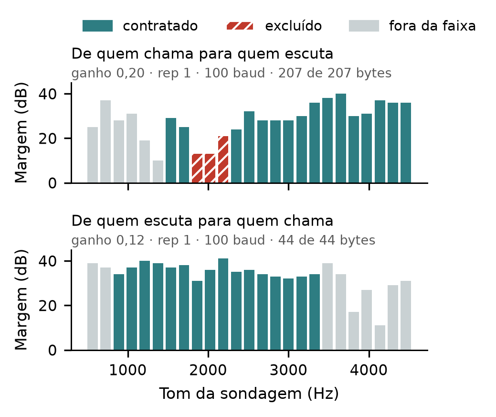

# Transmissão de dados por som audível entre dois computadores: o canal acústico medido e um modem para ele

<!-- SEGUNDA VERSÃO, recomeçada em 2026-10-29 depois dos pareceres. A primeira versão, como foi enviada, e os pareceres estão em primeiro-envio/ (artigo_modem.md, PARECERES.md). O roteiro discutido entre os autores está no artefato "Roteiro do artigo acústico". Voz impessoal, a pedido do revisor 1. Contas só onde forem considerações de implementação (sincronismo, janela de análise, espalhamento espectral e harmônicos). -->

**AUTORES:**

1. Winderson Nascimento Da Cruz | 0009-0007-0636-7160 | IFPR, Campus Jacarezinho | windersoncruz00@gmail.com
2. Jefferson Wilhelm Meyer Soares | 0000-0003-3372-9298 | IFPR, Campus Jacarezinho | jefferson.soares@ifpr.edu.br

**DOI:** https://doi.org/10.5281/zenodo.XXX

## RESUMO

Apresenta-se a transmissão de dados por som audível entre dois computadores, com alto-falante e microfone de uso geral, num canal em que frequências próximas chegam com níveis distintos, o ruído ocupa a mesma faixa e a cadeia analógica satura e gera harmônicos. Na camada física são comparadas quatro modulações por deslocamento de frequência, do inglês *frequency shift keying* (FSK), de um tom entre dois a um entre dezesseis, cada tom decidido contra o piso de ruído da sua frequência. Na camada de enlace, um código convolucional corrige os bits errados, varreduras de frequência marcam o quadro, e pacotes com verificação e retransmissão completam a entrega. Uma negociação pelo próprio som mede o canal e escolhe tons, nível e taxa em cada sentido. Com o alto-falante a aproximadamente 10 e 30 cm do microfone, as quatro formas entregaram o texto inteiro sem retransmissão. Um arquivo de 1334 bytes chegou idêntico, e o enlace negociado completou sessões nos dois sentidos sem configuração prévia.

**PALAVRAS-CHAVE:** Modem acústico. Modulação por deslocamento de frequência. Codificação convolucional. Canal acústico.

<!-- Resumo reaproveitado da primeira versão: frase solta "O meio acústico impõe condições severas" retirada, "emitida/recebida" no lugar de "chega/saiu", voz impessoal, negociação acrescentada. Os números finais ficam sujeitos à Tabela 1 (6.2). -->

## 1 INTRODUÇÃO

Rádio e infravermelho transferem dados sem cabo entre computadores próximos com taxas elevadas, mas exigem transceptor dedicado. O som usa o alto-falante e o microfone já presentes, ao custo de taxa baixa e alcance curto (LOPES; AGUIAR, 2003).

<!-- LOPES; AGUIAR (2003) lida em 2026-10-30 (PDF do ISR/IST), p. 62: "Sound offers features not available with other short-range, low bandwidth communication technologies, such as radio and infrared". -->

O uso do som para dados vem da rede telefônica. A modulação por deslocamento de frequência, do inglês *frequency shift keying* (FSK), representa cada valor de bit por uma frequência, e o padrão Bell 202 dos modems telefônicos usa 1200 e 2200 Hz a 1200 símbolos por segundo (FINNEGAN; BENSON, 2014). O mesmo padrão segue na instrumentação industrial, onde o protocolo HART superpõe um sinal FSK de 1200 bits por segundo à malha de corrente de 4 a 20 mA (WU, 2023).

Lopes e Aguiar (2001) levaram a transmissão para o ar, com várias frequências audíveis. O ar, porém, não é um par de fios: o som se propaga cerca de 875 mil vezes mais devagar que a onda eletromagnética, e em ambiente fechado as reflexões chegam dezenas de milissegundos depois do som direto (PUTZ *et al.*, 2026). Em uma revisão de 31 estudos, com mais de 11 mil transmissões em aparelhos reais, Putz *et al.* (2026) apontam esse multipercurso como a principal degradação e situam os produtos comerciais entre 10 e 200 bits por segundo. Uma implementação aberta que transmite quatro bits por tom opera entre 8 e 16 bytes por segundo (GERGANOV, 2021).

<!-- Os 8 a 16 B/s do ggwave vêm do README, conforme referencias.md. Conferir no repositório antes de submeter. -->

Este trabalho apresenta um modem acústico que transmite bytes entre dois computadores por som audível, com alto-falante e microfone de uso geral (Figura 1). O texto descreve o canal medido, as quatro formas de transmissão da camada física, a camada de enlace, com correção de erros, pacotes e a negociação do enlace pelo próprio som, e as medidas de cada recurso.

Figura 1 - Dados transmitidos como som de um computador e reconstruídos no outro a partir do microfone.

## 2 O CANAL ACÚSTICO

### 2.1 Frequência e detecção

A banda disponível para os dados é a faixa audível, porque é a que alto-falantes e microfones de uso geral reproduzem. Cada valor de bit, ou de grupo de bits, corresponde a uma frequência combinada entre as duas pontas. A cada intervalo fixo, chamado símbolo, o transmissor emite um tom e o receptor identifica qual esteve presente.

O receptor escolhe a frequência de maior energia. Um ganho comum a todas, vindo do volume ou da distância, não altera a escolha, mas a probabilidade de erro depende da relação sinal-ruído, do inglês *signal-to-noise ratio* (SNR), em cada frequência.

Com $M$ frequências, cada símbolo carrega $\log_2 M$ bits, e $M$ é limitado pela resolução da medida. Em uma janela de $N$ amostras, duas frequências só se distinguem quando separadas de pelo menos a resolução dada por (1).

$$\Delta f = \frac{f_s}{N} \tag{1}$$

Nela, $f_s$ é a taxa de amostragem e $N$, o número de amostras da janela. No sistema implementado, $f_s$ = 48 kHz e o símbolo tem 480 amostras, das quais as 72 primeiras formam um intervalo de descarte, e a janela de 408 dá $\Delta f$ ≈ 118 Hz. Os dezesseis tons da 16-FSK, espaçados de 162,5 Hz, respeitam esse limite, e mais tons na mesma faixa seriam lidos como o vizinho.

O descarte cobre a transição do tom anterior, que alto-falante e microfone não acompanham instantaneamente, e a incerteza sobre o instante em que o símbolo começa. Descartar mais limparia a janela, mas a encurtaria e pioraria $\Delta f$.

### 2.2 Efeitos do canal

Uma sala em silêncio não produz sinal nulo no microfone. Tráfego, máquinas e fala ocupam a faixa dos dados, de forma contínua e em rajadas (PUTZ *et al.*, 2026). Resulta um piso de ruído permanente, com nível diferente em cada frequência, que no sistema implementado (Figura 2) se concentra abaixo de 2 kHz e varia 27 dB sob os dezesseis tons da 16-FSK, de −67,6 a −94,8 dBFS.

Figura 2 - Piso de ruído com o enlace parado, média de quatro gravações de 8 s, com os extremos em cinza e os dezesseis tons no rodapé.

Um tom transmitido precisa superar o piso na sua frequência, e por isso cada tom é comparado com esse piso, e não com um limiar único.

O som chega ao microfone pelo caminho direto e por reflexões atrasadas, que o reforçam em algumas frequências e o cancelam em outras. A resposta do canal é um pente de máximos e mínimos fixado pela geometria (KUTTRUFF, 2016), em que frequências próximas podem chegar com níveis muito diferentes, e os mínimos se deslocam quando objetos ou pessoas se movem.

Vistas no tempo, as mesmas reflexões formam a reverberação. Na janela de um símbolo, o tom dos símbolos anteriores ainda soma energia à sua frequência e compete com o tom atual na decisão.

O espectro medido de um tom puro também não é uma linha única. Analisá-lo numa janela de $N$ amostras equivale a cortar um seno contínuo nas bordas da janela, o que espalha a energia pelas frequências próximas, efeito chamado vazamento espectral. O nível a uma distância $\delta$ do tom, relativo ao do tom, é dado por (2).

$$\frac{|X(f_0+\delta)|}{|X(f_0)|} = \left|\frac{\sin(\pi \delta N / f_s)}{\pi \delta N / f_s}\right| \tag{2}$$

Nela, $f_0$ é a frequência do tom e $X$, o espectro da janela. O nível se anula nos múltiplos de $f_s/N$, e os zeros em $\pm f_s/N$ delimitam o lóbulo principal. Os lóbulos laterais decrescem com a distância, e o primeiro fica cerca de 13 dB abaixo do pico.

No sistema implementado (Figura 3), o espectro das 408 amostras analisadas de um símbolo de 1700 Hz recebido coincide, em torno do tom, com o de um seno ideal cortado na mesma janela e calculado sem alto-falante, ar e microfone. O espalhamento vem, portanto, da janela, e não do canal.

Figura 3 - Tom de 1700 Hz recebido. (a) Um símbolo, com o intervalo de descarte e a janela. (b) Espectro da janela e de um seno ideal, com os dezesseis tons pontilhados.

O tom vizinho da 16-FSK, 162 Hz acima, cai no primeiro lóbulo lateral e recebe −13,0 dB, contra −13,4 dB previstos por (2). Essa margem separa um tom do vizinho na decisão, mesmo sem ruído.

O detector vê apenas a energia de cada um dos dezesseis tons na janela. A Figura 4 mostra esses valores no sistema implementado, com o tom de 1700 Hz transmitido, contra a curva de (2) para um seno no mesmo nível, somada em potência ao piso da sala em silêncio. O tom transmitido fica 47,4 dB acima do piso na sua frequência.

Figura 4 - Energia nos dezesseis tons com o de 1700 Hz transmitido, o previsto por (2) mais o piso (curva e círculos) e a sala em silêncio, mediana de quatro gravações (quadrados).

Os outros quinze tons sobem acima do silêncio porque recebem os lóbulos laterais do tom transmitido. Na mediana, o medido difere do previsto em 0,9 dB até 2,5 kHz e o excede em 4,5 dB acima disso, o que o vazamento não explica, e o maior desvio, 7,1 dB em 3325 Hz, fica a 75 Hz do segundo harmônico de 1700 Hz (Figura 5).

A cadeia analógica cria ainda frequências não transmitidas. Amplificador, alto-falante e microfone não são perfeitamente lineares e põem energia nos múltiplos inteiros da frequência de todo tom, os harmônicos, que crescem com o nível. Em nível alto, o cone do alto-falante e o amplificador atingem seus limites e achatam os picos.

Na varredura de 300 a 6000 Hz em seis segundos da Figura 5, recebida pelo ar no sistema implementado, o segundo harmônico de seis dos dezesseis tons cai a até 76 Hz de outro tom, e o terceiro de dois, a até 12 Hz, somando energia onde nada foi transmitido.

Figura 5 - Varredura de 300 a 6000 Hz recebida, em janelas de 4096 amostras, com os harmônicos nas diagonais e sons da sala nos riscos verticais.

<!-- Winderson: o caso do microfone mais antigo que entregava sinal espúrio entra aqui se houver registro (qual máquina, o que se viu). Sem registro, fica fora. Transmissão pela carcaça e pela mesa: sem medida no repositório, fora. -->

### 2.3 Limites dos transdutores

Alto-falantes e microfones de uso geral respondem bem na faixa da fala e perdem eficiência nos extremos (CAI; ZHENG; LUO, 2022), e por isso os tons das quatro formas ficam entre 700 e 3325 Hz. O ultrassom fica fora, porque a inaudibilidade deixa menos de 4 kHz de faixa, onde o hardware de áudio já é seletivo (PUTZ *et al.*, 2026), e a absorção do ar, que cresce com a frequência, encurta o alcance.

<!-- Caixa Bluetooth (atraso e compressão do codec) fora até haver número que o artigo use. -->

## 3 CAMADA FÍSICA

A camada física converte os bits em tons e, na recepção, o som captado de volta em bits, cada um com a confiança da decisão.

### 3.1 Formas de transmissão

Figura 6 - Tons emitidos por cada forma para o byte 1011 0010, com as frequências disponíveis em claro, as que soam em escuro e os bits de cada símbolo acima dele.

A Figura 6 mostra os tons que cada forma emite para o mesmo byte. A 2-FSK usa os tons do padrão Bell 202, 1200 e 2200 Hz, a 1200 símbolos por segundo (FINNEGAN; BENSON, 2014). O receptor multiplica o sinal por uma cópia atrasada de si mesmo, e o sinal algébrico do produto filtrado indica o tom presente. A decisão depende do nível relativo dos dois tons, e um canal que atenue mais um deles desloca todas as decisões no mesmo sentido.

A 5×2-FSK votada emite, a cada símbolo, um tom de cada um de cinco pares, todos com o mesmo bit, a 100 símbolos por segundo. Os tons de cada par distam 200 Hz, próximos o bastante para que o canal os trate de modo semelhante, e cada par vota no mais forte. A maioria dá o bit, e um par em um mínimo da resposta em pente perde a votação sem decidir o resultado.

A 5×2-FSK multicanal usa os mesmos pares como cinco canais 2-FSK independentes, cada um com um de cinco bits consecutivos dos dados. A taxa quintuplica, mas, sem votação, um par em um mínimo do pente perde o seu bit.

Nas duas formas de cinco pares, os dez tons são escolhidos para que nenhum segundo ou terceiro harmônico (Figura 5) de um tom do valor 0 caia sobre um tom do valor 1, nem o contrário, o que somaria energia ao valor errado.

A 16-FSK emite um tom por símbolo, entre dezesseis frequências de 888 a 3325 Hz espaçadas de cerca de 162 Hz, e carrega quatro bits a 100 símbolos por segundo. O erro mais provável é a confusão com o vizinho, que recebe o vazamento do tom transmitido (Figura 4). No binário comum, vizinhos podem diferir em até quatro bits, como 0111 e 1000, e por isso os valores seguem o código Gray, em que tons vizinhos diferem em um só bit. Um único tom recebe toda a amplitude disponível, enquanto nas formas de cinco pares cinco tons dividem o mesmo pico e cada um sai cerca de 14 dB abaixo do que sairia sozinho.

### 3.2 Decisão contra o piso

O receptor da 16-FSK divide a energia de cada tom na janela pelo piso de ruído corrente daquela frequência (seção 2.2) e escolhe o maior, conforme (3).

$$\hat{k} = \arg\max_k \frac{E_k}{P_k} \tag{3}$$

Nela, $E_k$ é a energia no tom $k$ e $P_k$ é a média corrente dessa energia, atualizada a cada símbolo em todos os tons menos o vencedor. Como cada tom fica em silêncio em quinze de cada dezesseis símbolos, essa média estima o piso sem contaminação pelo sinal. A Figura 7 mostra essa decisão em um símbolo recebido no sistema implementado.

Figura 7 - Decisão da 16-FSK em um símbolo. Em cima, o espectro e o piso corrente de cada tom, e embaixo, a energia de cada tom sobre o piso, comparada em (3).

Além do valor decidido, o receptor entrega a confiança de cada bit, a diferença, em logaritmo, entre o melhor tom em que o bit vale 1 e o melhor em que vale 0. Essa confiança, chamada verossimilhança logarítmica, do inglês *log-likelihood ratio* (LLR), é usada pela camada de enlace na correção de erros.

### 3.3 Sincronismo de símbolo

Os dois computadores não compartilham relógio, e as contagens dos seus osciladores se afastam pouco a pouco. O receptor precisa descobrir onde começa cada símbolo e quanto ele dura de fato. A primeira implementação usou uma malha de adiantamento e atraso. A cada símbolo, o receptor mede o tom também um pouco antes e depois do instante esperado e desloca a leitura seguinte para o lado em que o tom aparece mais nítido. Só há o que medir quando o tom muda, e por isso a transmissão começa com um preâmbulo de tons alternados, que dá à malha tempo de se ajustar. Enquanto não se ajusta, o que leva alguns símbolos, a malha lê errado justamente o início do quadro, onde estão a palavra de referência e os primeiros bits do bloco.

A implementação atual marca o quadro por fora, com uma varredura em cada extremidade, um som de 80 ms cuja frequência sobe continuamente de 700 a 3400 Hz, como um assobio do grave ao agudo. A varredura não se confunde com os tons dos dados nem com o ruído e resiste ao multipercurso (CAI; ZHENG; LUO, 2022). O receptor a localiza comparando o sinal recebido, posição a posição, com uma cópia dela, pela correlação usada também para a palavra de referência (seção 4.2), e a primeira varredura dá o início do quadro. A distância entre as varreduras dá também o período real do símbolo, conforme (4).

$$T = \frac{n_2 - n_1}{S} \tag{4}$$

Nela, $n_1$ e $n_2$ são as posições das duas varreduras, em amostras, e $S$ é o número de símbolos entre elas.

Na Figura 8, um quadro de 18 símbolos que não passou pelo ar, no formato do visor da seção 5, o receptor marca $n_1$ no fim da primeira varredura e $n_2$ no início da segunda, e (4) dá as fronteiras de símbolo.

Figura 8 - Quadro curto de 16-FSK entre as duas varreduras, com a frequência na horizontal, o mais recente no alto e as fronteiras de (4) em linhas finas.

No sistema implementado, em quatro quadros de 2453 símbolos recebidos entre as duas máquinas, o período medido por (4) variou de 479,90 a 480,07 amostras, contra 480 nominais. Um desvio de 0,1 amostra por símbolo acumula cerca de 245 amostras no quadro, meio símbolo e mais que as 72 do intervalo de descarte, e com o período nominal o fim do quadro seria lido fora do símbolo. Pelo mesmo cálculo, $S$ tem de ser exato, pois um símbolo a mais ou a menos erra o período em 480/2453 ≈ 0,2 amostra, e o erro acumulado no quadro chega a um símbolo inteiro.

No enlace negociado da seção 4.4, todo quadro leva as duas varreduras e o receptor usa só elas, e a malha fica apenas no primeiro protótipo, configurado por comandos, em que as varreduras são opcionais.

### 3.4 Nível de operação

Como a cadeia analógica achata os picos e gera harmônicos acima de certo nível (seção 2.2), o volume do alto-falante e o ganho de captura ficam abaixo desse ponto em todos os ensaios. Na 16-FSK, no sistema implementado, a troca abrupta de tom a cada símbolo produz picos cerca de 2,5 vezes maiores que os de um tom contínuo, e por isso o nível é calibrado com uma transmissão real, e não com um tom.

<!-- Pendente: confirmar com o autor se a 2-FSK da Tabela 1 é a de Bell 202 (1200/2200 Hz, 1200 baud, sem correção de erros) ou a 2-FSK justa de 1700/2350 Hz a 100 baud com FEC (fsk2 no código). O texto acima descreve a de Bell 202, como a primeira versão. Gray: o código foi corrigido em 2026-10-29 (valor = gray(tom)); a Tabela 1 precisa ser medida já com essa versão. -->

## 4 CAMADA DE ENLACE

A camada de enlace recebe da camada física os bits com a sua confiança e entrega à aplicação os dados íntegros e na ordem de envio.

### 4.1 Correção de erros

Mesmo com o nível ajustado, parte dos bits chega trocada. Para corrigi-los sem retransmitir, o transmissor envia bits além dos da mensagem, a redundância, com os quais o receptor desfaz as trocas.

A redundância mais simples é repetir cada bit três vezes e decidir pela maioria, o que corrige uma cópia trocada, mas cada cópia só confere o próprio bit. Duas cópias trocadas bastam para a maioria errar, mesmo com os vizinhos certos.

O sistema usa um código convolucional, que também envia três bits por bit da mensagem, mas nenhum deles é cópia. Cada bit enviado resulta de uma operação lógica entre o bit que entra e alguns dos anteriores, e por isso confere vários bits da mensagem de uma vez. Um bit trocado no ar é então reconstituído pelos demais que dependem dos mesmos bits da mensagem.

A operação é o ou-exclusivo, que dá 1 quando a quantidade de uns é ímpar e 0 quando é par. O codificador guarda em fila os sete últimos bits da mensagem, e cada um dos três bits enviados é o ou-exclusivo de um grupo diferente desses sete (Figura 9), de modo que cada bit da mensagem participa de sete cálculos seguidos. Na nomenclatura da literatura, o código tem taxa um terço, três bits enviados por bit da mensagem, e comprimento de restrição sete, os sete bits de cada cálculo (PROAKIS; SALEHI, 2008).

Figura 9 - Codificador convolucional com um exemplo e, ao lado de cada linha, o padrão de ligações em binário e em octal.
Na recepção, o algoritmo de Viterbi procura a mensagem cuja codificação mais se parece com o que chegou (VITERBI, 1967; FORNEY, 1973). Como cada bit da mensagem entra em vários bits enviados, uma mensagem errada discorda do recebido em muitas posições, e a certa, só nas poucas trocadas. Cada discordância pesa conforme a confiança do bit, o que se chama decisão suave, e um bit trocado com baixa confiança quase não pesa.

No bloco da Figura 10, recebido no sistema implementado, 112 dos 1170 bits codificados chegaram errados, 9,6%, e a mensagem saiu sem erro, porque 107 dos 112 errados chegaram com confiança abaixo de 1,7, contra 273 dos 1058 certos, e pesaram pouco.

Figura 10 - Bloco de 48 bytes em 16-FSK. Em cima, os bits codificados errados, no meio, a mensagem decodificada, e embaixo, os bits errados e certos por faixa de confiança.

Os bits codificados são entrelaçados, escritos em linhas e lidos em colunas, o que afasta no tempo bits vizinhos no código, e uma perturbação curta, como um ruído de rajada, atinge bits espalhados, que o decodificador corrige um a um. O bloco pode ainda ser repetido, o que aumenta a tolerância a erros à custa de tempo no ar.

### 4.2 Localização do bloco

A camada física entrega uma sequência contínua de bits, com o preâmbulo e o que veio antes e depois do bloco, sem indicar onde ele começa, e decodificar a partir de um bit adiantado ou atrasado já produz mensagem errada. Contar os bits desde o início não resolve, pois a malha da seção 3.3 pode ganhar ou perder no preâmbulo um símbolo, que na 16-FSK vale quatro bits.

Logo antes do bloco o transmissor coloca uma palavra de referência de 31 bits, conhecida pelas duas pontas. O receptor desliza essa palavra sobre os bits recebidos e conta as coincidências em cada posição. Essa busca é a correlação, e o bloco começa no bit seguinte ao da maior coincidência. A Figura 11 mostra a palavra no quadro transmitido, entre o preâmbulo e o bloco codificado, que ocupa a maior parte do tempo no ar.

Figura 11 - Quadro de 48 bytes em 16-FSK, em escala de tempo, entre as duas varreduras.

### 4.3 Pacotes e retransmissão

Para transferir um arquivo, os dados são divididos em pacotes com número de sequência, comprimento e verificação de redundância cíclica, do inglês *cyclic redundancy check* (CRC), de 16 bits. O receptor pede um pacote, confere o CRC e só então pede o seguinte, repetindo o pedido até quatro vezes se a verificação falhar, no arranjo pare-e-espere dos protocolos de enlace (TANENBAUM; WETHERALL, 2011). Ao fim, um CRC de 32 bits confirma o arquivo inteiro. A retransmissão só converge se a maioria dos pacotes chegar íntegra na primeira tentativa, e por isso complementa a correção de erros sem substituí-la.

### 4.4 Negociação do enlace pelo ar

Até aqui, as duas pontas combinam de antemão a forma de transmissão, os tons, o nível e a taxa. A negociação faz esse acordo pelo próprio som no início de cada sessão, sem canal auxiliar nem ajuste manual. A estação que chama emite um par de varreduras de frequência, e a que escuta responde. Cada uma sonda então o canal no sentido em que transmite, com tons isolados em todas as frequências candidatas e com blocos conhecidos em volumes crescentes do alto-falante.

Em cada sentido, quem recebe a sondagem decide a configuração. O acordo, chamado contrato, fixa a modulação, 16-FSK ou 2-FSK, os tons utilizáveis, o volume do alto-falante de quem transmite, o ganho do microfone de quem recebe, a velocidade em símbolos por segundo e o número de repetições do bloco codificado (seção 4.1). Enviado o contrato, os dados seguem em pare-e-espere (Figura 12), e se os pacotes falham repetidamente o transmissor recua para mais repetições ou menos símbolos por segundo.

Figura 12 - Sessão negociada, da chamada aos dados, em escala de tempo, com uma seta por turno e, tracejado, um pacote ilegível pedido de novo e retransmitido.

A medição se repete a cada sessão porque o canal muda com o tempo. No sistema implementado, em três séries de gravações do mesmo dia, três dos dezesseis tons concentraram de 47% a 90% dos erros de símbolo de cada série, e não foram os mesmos de uma série para outra (Figura 13).

Figura 13 - Fração dos erros de símbolo por tom em três séries do mesmo dia e sentido, com os três piores tons cheios e a distribuição uniforme pontilhada.

## 5 INTERFACE COM A APLICAÇÃO

O enlace é operado por um aplicativo, para computador e para celular Android, cuja tela, o visor, inicia a sessão, mostra o estado do enlace e apresenta ao final os dados recebidos. Nele (Figura 14), o espectrograma do microfone, com o mais recente no alto, mostra os sinais que chegam, e a escala de frequência acima dele marca os tons contratados em cada sentido.

Figura 14 - Visor no computador (a) e no celular (b), durante a troca de dados.

<!-- Figura 14 PROVISÓRIA: as duas telas ainda mudam (percurso e régua de tons); refazer no fim dos testes, com resultados/FIG-TELAS/COMO-REFAZER.md. Chat e terminal: descrever quando estiverem prontos (outra sessão). Porta serial virtual: hoje só app.py --pty, sobre a 2-FSK de Bell 202 sem correção de erros, que não entregou mensagem pelo ar; o enlace negociado não expõe porta serial. O resumo e a introdução afirmam a porta serial virtual: rever. -->

## 6 RESULTADOS EXPERIMENTAIS

Os ensaios foram feitos numa sala, com o aplicativo nas duas pontas. O alto-falante ficou a aproximadamente 10 cm do microfone ou afastado dele, e também a aproximadamente 30 cm no ensaio das formas, sempre com o nível abaixo da saturação.

Com o alto-falante a aproximadamente 10 e 30 cm do microfone, cada forma enviou o mesmo texto de 320 bytes em 10 pacotes de 32 bytes, a 100 símbolos por segundo e com repetição 3, configurados à mão nas duas pontas. A Figura 15 mostra a taxa efetiva de cada uma, do primeiro envio à última confirmação, e a fração dos cerca de 29 mil bits recebidos que chegaram errados antes da correção.

Figura 15 - Taxa efetiva e bits recebidos errados de cada forma de transmissão, a aproximadamente 10 e 30 cm.

Nas duas distâncias as quatro formas entregaram o texto idêntico ao enviado, sem retransmissão. A 16-FSK e a 5×2-FSK multicanal são quase três vezes mais rápidas que a 2-FSK e a 5×2-FSK votada, e a aproximadamente 30 cm são as que mais erram antes da correção, enquanto a 5×2-FSK votada quase não erra.

<!-- Fontes: H09-QUATRO-FORMAS-10CM e H09-QUATRO-FORMAS-30CM (RESUMO.md; uma sessão por forma e distância, 2026-10-30; a 10 cm a votada com o embaralhamento da carga e as outras sem, a 30 cm todas com; 2-FSK a 30 cm: a sessão refeita, repeticao/2fsk/, escolha do autor; a primeira, com 4 retransmissões e 6,76%, ficou fora). Script: resultados/H09-QUATRO-FORMAS-10CM/figuras/figura_formas.py. A figura antiga (blocos de 48 bytes entre computadores, F02 com uma gravação excluída) saiu pela regra do autor: só testes em que as quatro formas passam. -->

A Figura 16 compara as duas formas de sincronismo da seção 3.3, a malha de adiantamento e atraso e as varreduras nas pontas do quadro, sobre as mesmas 24 gravações de blocos de 48 bytes em 16-FSK, feitas num único computador que tocava e gravava ao mesmo tempo.

Figura 16 - Bits certos ao longo do quadro, em janelas de 5%, na média de 24 gravações lidas com a malha e com as varreduras.

Com as varreduras, o acerto fica perto de 91% desde o primeiro bit, e com a malha cai a 83,5% nos primeiros 10% do quadro, até ela se ajustar. É nesse trecho que fica a palavra de referência, e um início mal lido basta para o bloco se perder: a malha entregou 15 dos 24 blocos, e as varreduras, 23.

<!-- Fontes: 12-13-SYNC (4 gravações, 192 B, rep 2), H03-2FSK-FEC (as 8 com varreduras), studies/20260903-111105-ganho-mary (uma máquina, ganho 0,20 a 0,38). -->

Com os pacotes da seção 4.3, uma imagem de 1334 bytes transferida entre os dois computadores com o alto-falante afastado chegou idêntica, conferida pelo CRC de 32 bits. Em pacotes de 64 bytes, os 21 chegaram sem retransmissão, a 6,8 B/s, e em pacotes de 128 bytes, os 11 chegaram com 3 retransmissões, a 7,2 B/s. A aproximadamente 10 cm, três transferências da mesma imagem também chegaram idênticas, de 5,0 a 7,6 B/s. A taxa fica abaixo da do bloco isolado pelo preâmbulo, pelo cabeçalho e pela espera entre pacotes.

As duas imagens da Figura 17 foram enviadas com o alto-falante a aproximadamente 10 cm do microfone, em 16-FSK a 100 símbolos por segundo e pacotes de 32 bytes, configurados à mão nas duas pontas, e chegaram idênticas, conferidas pelo CRC de 32 bits, com todos os pacotes na primeira tentativa. O logotipo, de 1270 bytes, chegou em 40 pacotes, com o bloco sem repetição, em 329 s, ou 3,9 B/s, com 5,0% dos bits recebidos errados. A bandeira, de 934 bytes, chegou em 30 pacotes, com o bloco repetido duas vezes, em 324 s, ou 2,9 B/s, com 5,4%. A correção recuperou todos os bits errados, e em pacotes curtos a espera pela confirmação pesa mais na taxa.

Figura 17 - Imagens recebidas a aproximadamente 10 cm, idênticas às enviadas.

No enlace negociado, sem configuração prévia e com os computadores a cerca de 2 m, uma sessão entregou completos os 207 bytes de um sentido e os 44 do outro, em 302 s contados da chamada. A Figura 18 mostra a sondagem e o contrato de cada sentido.

Figura 18 - Margem de cada tom na sondagem, por sentido, com os tons contratados e, acima, ganho digital, repetição, velocidade e bytes entregues.

Num sentido, o receptor excluiu os três tons de margem mais baixa, entre 1862 e 2188 Hz, e deslocou a faixa para cima. No outro, todos os tons da faixa de fábrica tinham mais de 30 dB de margem e ficaram. Os ganhos contratados foram 0,20 e 0,12. Com outro computador numa das pontas, outra sessão se completou em 405 s.

<!-- Fontes: H07-ENLACE-MODOS (2026-10-22), H06-ENLACE-AR sessão 3 (contratos: A->B exclui 4 tons, ganho 0,45, rep 2; B->A exclui 3, ganho 0,3, rep 1), sessoes-enlace-2maq/20261027-175531 (405 s). Figura do visor em modo projeção com as fases: a capturar. 6.6 chat e terminal: quando medidos. -->

## 7 CONSIDERAÇÕES FINAIS

Apresentou-se um modem acústico com alto-falante e microfone de uso geral, operado por um aplicativo para computador e para celular Android. A camada física decide cada tom contra o piso de ruído da sua frequência e entrega a confiança de cada bit, que a camada de enlace usa para corrigir os errados, e as varreduras nas pontas do quadro dão o instante de cada símbolo desde o início do bloco, onde a malha de adiantamento e atraso ainda se ajusta.

Com o alto-falante a aproximadamente 10 e 30 cm do microfone, as quatro formas entregaram o texto inteiro sem retransmissão, e a 16-FSK e a 5×2-FSK multicanal foram quase três vezes mais rápidas que a 2-FSK e a 5×2-FSK votada. Com o alto-falante afastado, um arquivo de 1334 bytes chegou idêntico em 21 pacotes, sem retransmissão, e o enlace negociado completou uma sessão nos dois sentidos sem configuração prévia, cada receptor escolhendo os próprios tons e ganho.

Esses resultados valem para uma sala e, nas formas de transmissão, para uma sessão de cada.

<!-- Capítulo 7 redigido em 2026-10-30, no molde das considerações finais da primeira versão e do artigo da roda de reação: o que foi feito, o que foi medido, o limite e o passo seguinte. Rever quando entrarem 1 m e 2 m. -->

## DECLARAÇÃO DE USO DE INTELIGÊNCIA ARTIFICIAL GENERATIVA

Em conformidade com a Portaria CNPq nº 2.664/2026, os autores declaram o uso de Claude-Code (Anthropic) e Codex (OpenAI) na concepção, para discussão da abordagem e levantamento de referências, na implementação e na análise, para redação e depuração do software do modem e dos scripts de ensaio, e na redação do texto, para clareza e correção de linguagem. Todo o conteúdo gerado foi verificado e editado pelos autores, que assumem responsabilidade integral pelo trabalho.

<!-- A primeira versão dizia "firmware"; o projeto não tem firmware, trocado por "software do modem". -->

## CONFLITO DE INTERESSES

Os autores declaram não haver conflito de interesses no desenvolvimento e na publicação deste trabalho.

## REFERÊNCIAS

CAI, Chao; ZHENG, Rong; LUO, Jun. Ubiquitous acoustic sensing on commodity IoT devices: a survey. **IEEE Communications Surveys & Tutorials**, v. 24, n. 1, p. 432-454, 2022. DOI: 10.1109/COMST.2022.3145856.

FINNEGAN, Kenneth W.; BENSON, Bridget. Clarifying the amateur Bell 202 modem. In: **ARRL/TAPR Digital Communications Conference (DCC)**, 33., 2014. Anais [...]. [S.l.]: TAPR, 2014.

FORNEY JR., G. David. The Viterbi algorithm. **Proceedings of the IEEE**, v. 61, n. 3, p. 268-278, mar. 1973.

GERGANOV, Georgi. **ggwave**: tiny data-over-sound library. 2021. Disponível em: https://github.com/ggerganov/ggwave.

KUTTRUFF, Heinrich. **Room acoustics**. 6. ed. Boca Raton: CRC Press, 2016.

LOPES, Cristina Videira; AGUIAR, Pedro M. Q. Aerial acoustic communications. In: **IEEE Workshop on Applications of Signal Processing to Audio and Acoustics (WASPAA)**, 2001, New Paltz. Anais [...]. New Paltz: IEEE, 2001.

LOPES, Cristina Videira; AGUIAR, Pedro M. Q. Acoustic modems for ubiquitous computing. **IEEE Pervasive Computing**, v. 2, n. 3, p. 62-71, 2003. DOI: 10.1109/MPRV.2003.1228528.

PROAKIS, John G.; SALEHI, Masoud. **Digital communications**. 5. ed. Nova York: McGraw-Hill, 2008.

PUTZ, Florentin; FORTMANN, Philipp; FRANK, Jan; HAUGWITZ, Christoph; KUPNIK, Mario; HOLLICK, Matthias. Evaluating acoustic data transmission schemes for ad-hoc communication between nearby smart devices. **ACM Transactions on Internet of Things**, v. 7, n. 1, art. 8, 2026. arXiv:2602.02249.

TANENBAUM, Andrew S.; WETHERALL, David J. **Computer networks**. 5. ed. Boston: Pearson, 2011.

VITERBI, Andrew J. Error bounds for convolutional codes and an asymptotically optimum decoding algorithm. **IEEE Transactions on Information Theory**, v. IT-13, n. 2, p. 260-269, abr. 1967.

WU, Joseph. **A basic guide to the HART protocol**. Dallas: Texas Instruments, nov. 2023. (Application Report SLAAEH0). Disponível em: https://www.ti.com/lit/pdf/slaaeh0.

<!-- KUTTRUFF, PROAKIS, TANENBAUM e VITERBI ficam se os capítulos 2 a 4 os citarem; retirar os que sobrarem sem citação. -->
