# Transmissão de dados por som audível entre dois computadores: o canal acústico medido e um modem para ele

<!-- SEGUNDA VERSÃO, recomeçada em 2026-10-29 depois dos pareceres. A primeira versão, como foi enviada, e os pareceres estão em primeiro-envio/ (artigo_modem.md, PARECERES.md). O roteiro discutido entre os autores está no artefato "Roteiro do artigo acústico". Voz impessoal, a pedido do revisor 1. Contas só onde forem considerações de implementação (sincronismo, janela de análise, espalhamento espectral e harmônicos). -->

**AUTORES:**

1. Winderson Nascimento Da Cruz | 0009-0007-0636-7160 | IFPR, Campus Jacarezinho | windersoncruz00@gmail.com
2. Jefferson Wilhelm Meyer Soares | 0000-0003-3372-9298 | IFPR, Campus Jacarezinho | jefferson.soares@ifpr.edu.br

**DOI:** https://doi.org/10.5281/zenodo.XXX

## RESUMO

Este trabalho apresenta a transmissão de dados por som audível entre dois computadores, com alto-falante e microfone de uso geral. No canal acústico a amplitude recebida difere da emitida, frequências próximas chegam com níveis distintos, o ruído do ambiente ocupa a mesma faixa e a cadeia analógica, em nível alto, satura e gera harmônicos. O sistema trata essas condições em duas camadas. Na camada física são comparadas quatro modulações por deslocamento de frequência, do inglês *frequency shift keying* (FSK). A primeira (2-FSK) transmite um bit por símbolo, em um de dois tons. A segunda (5×2-FSK votada) também transmite um bit por símbolo, repetido em cinco pares de tons para tornar a decisão mais confiável. A terceira (5×2-FSK multicanal) usa os mesmos cinco pares para transmitir cinco bits distintos ao mesmo tempo. A quarta (16-FSK) emite um único tom por símbolo, escolhido entre dezesseis, e cada tom carrega quatro bits. Na camada de enlace, a correção antecipada de erros por código convolucional, o sincronismo de quadro por palavra de referência e por varreduras de frequência, os pacotes com verificação de redundância cíclica e a retransmissão automática recuperam os bits que a camada física pode entregar errados. Um protocolo de negociação pelo próprio som mede o canal em cada sentido e escolhe a modulação e a taxa sem configuração prévia. Na melhor configuração medida, a 16-FSK com correção de erros entregou 11,3 bytes por segundo com todos os blocos íntegros, e um arquivo de 1334 bytes chegou idêntico ao enviado em 21 pacotes, sem retransmissão.

**PALAVRAS-CHAVE:** Modem acústico. Modulação por deslocamento de frequência. Codificação convolucional. Canal acústico.

<!-- Resumo reaproveitado da primeira versão: frase solta "O meio acústico impõe condições severas" retirada, "emitida/recebida" no lugar de "chega/saiu", voz impessoal, negociação acrescentada. Os números finais ficam sujeitos à Tabela 1 (6.2). -->

## 1 INTRODUÇÃO

A transferência de dados entre dois computadores próximos, sem cabo, depende de um meio físico que os dois compartilhem. Rádio e infravermelho cumprem esse papel com taxas elevadas, mas exigem transceptor dedicado. O som usa o alto-falante e o microfone já presentes nos computadores, ao custo de taxa baixa e alcance curto (LOPES; AGUIAR, 2003).

<!-- LOPES; AGUIAR (2003) está fechada (IEEE Xplore 1228528) e ainda não foi lida. Abrir pelo Periódicos CAPES e conferir que a comparação está lá antes de manter a citação. -->

O uso do som para dados tem precedente na rede telefônica. A modulação por deslocamento de frequência, do inglês *frequency shift keying* (FSK), representa cada valor de bit por uma frequência. O padrão Bell 202, desenvolvido pela AT&T para modems telefônicos, usa 1200 e 2200 Hz a 1200 símbolos por segundo (FINNEGAN; BENSON, 2014).

O mesmo padrão segue em uso na instrumentação industrial. O protocolo de transdutor remoto endereçável, do inglês *Highway Addressable Remote Transducer* (HART), superpõe um sinal FSK de 1200 bits por segundo à malha de corrente de 4 a 20 mA, sem alterar o valor analógico que ela transporta (WU, 2023).

A transmissão pelo ar com várias frequências na faixa audível foi demonstrada por Lopes e Aguiar (2001). O ar, porém, difere do par de fios. O som se propaga a cerca de 343 m/s, aproximadamente 875 mil vezes mais devagar que a onda eletromagnética, e as reflexões em ambiente fechado chegam ao receptor dezenas de milissegundos depois do som direto (PUTZ *et al.*, 2026).

Em uma revisão de 31 estudos, com mais de 11 mil transmissões em aparelhos reais, Putz *et al.* (2026) apontam o multipercurso como a principal degradação dos esquemas acústicos e situam os produtos comerciais entre 10 e 200 bits por segundo. Uma implementação aberta que também transmite quatro bits por tom opera entre 8 e 16 bytes por segundo (GERGANOV, 2021).

<!-- Os 8 a 16 B/s do ggwave vêm do README, conforme referencias.md. Conferir no repositório antes de submeter. -->

Este trabalho apresenta um modem acústico que transmite bytes entre dois computadores por som audível, com alto-falante e microfone de uso geral, e que se apresenta à aplicação como uma porta serial virtual. São descritos os fenômenos do canal que afetam a transmissão, as quatro modulações implementadas, a camada de enlace e a negociação do enlace pelo próprio som, seguidos das medidas de cada recurso entre duas máquinas. A Figura 1 mostra o arranjo.

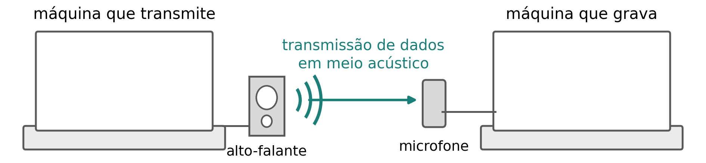
Figura 1 - O sistema. Os dados saem de uma máquina como som, atravessam o ar e são reconstruídos na outra a partir do que o microfone capta.

## 2 O CANAL ACÚSTICO

### 2.1 Frequência e detecção

O som é uma onda mecânica de pressão que se propaga no ar a cerca de 343 m/s. O trabalho usa a faixa audível porque é a que alto-falantes e microfones de uso geral reproduzem, e a resposta desses transdutores define a banda disponível para os dados.

Cada valor de bit, ou de grupo de bits, é associado a uma frequência combinada entre as duas pontas. A cada intervalo fixo, chamado símbolo, o transmissor emite o tom do valor a enviar, e o receptor identifica qual tom esteve presente naquele intervalo. Tons são preferidos à fala porque um tom puro concentra a energia em uma única frequência, enquanto a fala ocupa uma banda larga e varia com o locutor.

O receptor mede a energia em cada frequência combinada e escolhe a maior. Como a decisão compara as frequências entre si, um ganho comum a todas, introduzido pelo volume ou pela distância, não altera o resultado. A probabilidade de erro, porém, continua dependendo da relação sinal-ruído, do inglês *signal-to-noise ratio* (SNR), em cada frequência.

Com $M$ frequências, cada símbolo carrega $\log_2 M$ bits, e o número de frequências é limitado pela resolução da medida. A energia de cada tom é medida em uma janela de $N$ amostras, e duas frequências só se distinguem quando separadas de pelo menos a resolução dada por (1).

$$\Delta f = \frac{f_s}{N} \tag{1}$$

Nela, $f_s$ é a taxa de amostragem e $N$ o número de amostras da janela. No sistema implementado, com $f_s$ = 48 kHz e o símbolo de 480 amostras, do qual as primeiras 72 formam um intervalo de descarte, a janela tem 408 amostras e $\Delta f$ ≈ 118 Hz. O descarte existe porque o início do símbolo ainda contém a transição do tom anterior, que alto-falante e microfone não acompanham instantaneamente, e porque o receptor não conhece com exatidão o instante em que o símbolo começa. Um descarte maior limparia mais a janela, mas a encurtaria e pioraria $\Delta f$. Os dezesseis tons da 16-FSK, espaçados de 162,5 Hz, ficam acima desse limite, e mais tons na mesma faixa passariam a ser lidos como o vizinho.

### 2.2 Efeitos do canal

Uma sala em silêncio não produz sinal nulo no microfone. Tráfego, máquinas e fala ocupam a mesma faixa dos dados, em componentes contínuos e em rajada (PUTZ *et al.*, 2026), e o próprio microfone acrescenta ruído e processamento internos, que diferem de uma máquina para outra. O resultado é um piso de ruído presente o tempo todo, com nível diferente em cada frequência.

A Figura 2 mostra esse piso no sistema implementado, medido com o enlace parado em quatro gravações de 8 s, em janelas de 50 Hz. O piso concentra-se abaixo de 2 kHz e varia 27 dB sob os dezesseis tons da 16-FSK, de −67,6 a −94,8 dBFS.

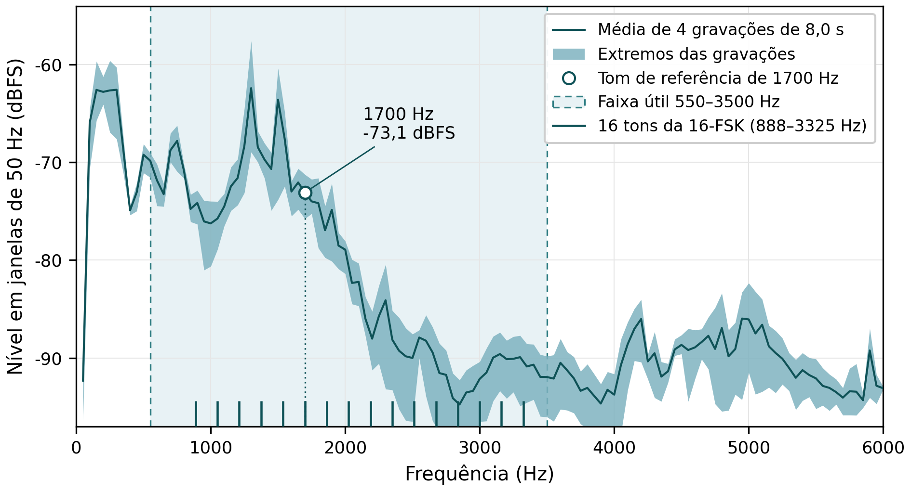
Figura 2 - Piso de ruído com o enlace parado, média de quatro gravações de 8 s. A faixa cinza são os extremos entre elas, e as marcas no rodapé, os dezesseis tons.

Um tom transmitido precisa, portanto, superar o piso de ruído na sua frequência, e não o silêncio. A detecção depende da razão entre a energia do tom e a desse piso, que é a SNR, e um mesmo nível de transmissão dá margens diferentes a tons diferentes. Por isso cada tom é comparado com o piso da sua própria frequência, e não com um limiar único.

Entre o conversor do transmissor e o do receptor estão o amplificador, o alto-falante, o ar, as superfícies que refletem ou absorvem o som e o microfone. Cada um deles altera o tom emitido, de modo que o sinal recebido difere do emitido mesmo na ausência de ruído.

O sinal chega ao microfone pelo caminho direto e por reflexões nas superfícies, cada uma atrasada pelo percurso que fez. Uma cópia atrasada reforça o som direto em algumas frequências e o cancela em outras, e a resposta do canal toma a forma de um pente de máximos e mínimos fixado pela geometria (KUTTRUFF, 2016). Frequências próximas podem chegar com níveis muito diferentes, e a posição dos mínimos muda quando objetos ou pessoas se movem na sala.

As mesmas reflexões, vistas no tempo, formam a reverberação, e a energia de um símbolo ainda está presente quando o seguinte começa. Na janela de um símbolo, o tom dos símbolos anteriores ainda soma energia à sua frequência e compete com o tom atual na decisão.

Um tom puro também não chega como uma única linha no espectro. O receptor analisa cada tom apenas durante a janela de $N$ amostras, o que equivale a observar um seno contínuo cortado nas bordas da janela. Esse corte espalha a energia do tom pelas frequências próximas, efeito chamado vazamento espectral, e o nível a uma distância $\delta$ do tom, relativo ao do próprio tom, é dado por (2).

$$\frac{|X(f_0+\delta)|}{|X(f_0)|} = \left|\frac{\sin(\pi \delta N / f_s)}{\pi \delta N / f_s}\right| \tag{2}$$

Nela, $f_0$ é a frequência do tom, $X$ é o espectro da janela, e $N$ e $f_s$ são os de (1). O nível se anula nos múltiplos de $f_s/N$, e entre esses zeros forma lóbulos que decrescem com a distância. Os zeros em $\pm f_s/N$ delimitam o lóbulo principal, e o primeiro lóbulo lateral fica cerca de 13 dB abaixo do pico.

A Figura 3 mostra esse efeito no sistema implementado. Em (a) está um símbolo do tom de 1700 Hz gravado pelo microfone da outra máquina, com as 72 amostras descartadas e as 408 analisadas. Em (b), o espectro dessas 408 amostras é comparado com o de um seno ideal de 1700 Hz, calculado no computador e cortado na mesma janela, sem passar por alto-falante, ar e microfone. As duas curvas coincidem em torno do tom, de modo que o espalhamento vem da janela, e não do canal.

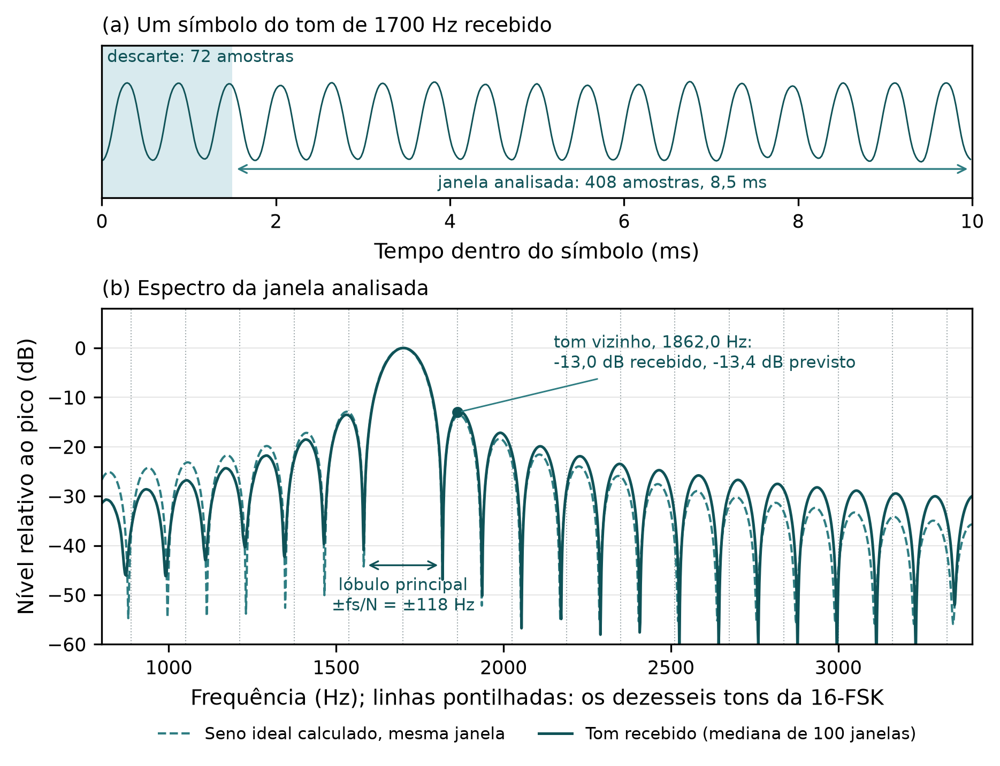
Figura 3 - Tom de 1700 Hz recebido. (a) Um símbolo, com o intervalo de descarte e a janela analisada. (b) Espectro da janela, contra um seno ideal calculado e cortado na mesma janela. As linhas pontilhadas marcam os dezesseis tons da 16-FSK.

O tom vizinho da 16-FSK, 162 Hz acima, cai no primeiro lóbulo lateral e recebe −13,0 dB, contra −13,4 dB previstos por (2). Essa é a margem que separa um tom do vizinho na decisão, mesmo sem ruído, e diminui se os tons forem aproximados.

O detector não vê o espectro contínuo da Figura 3, e sim um valor por tom, a energia medida na janela em cada uma das dezesseis frequências. A Figura 4 mostra esses valores no sistema implementado, com o tom de 1700 Hz transmitido, sobre a curva prevista por (2) para um seno ideal no mesmo nível, somada em potência ao piso de ruído da sala em silêncio. O tom transmitido fica 47,4 dB acima do nível da mesma frequência com a sala em silêncio, que é a sua margem sobre o piso.

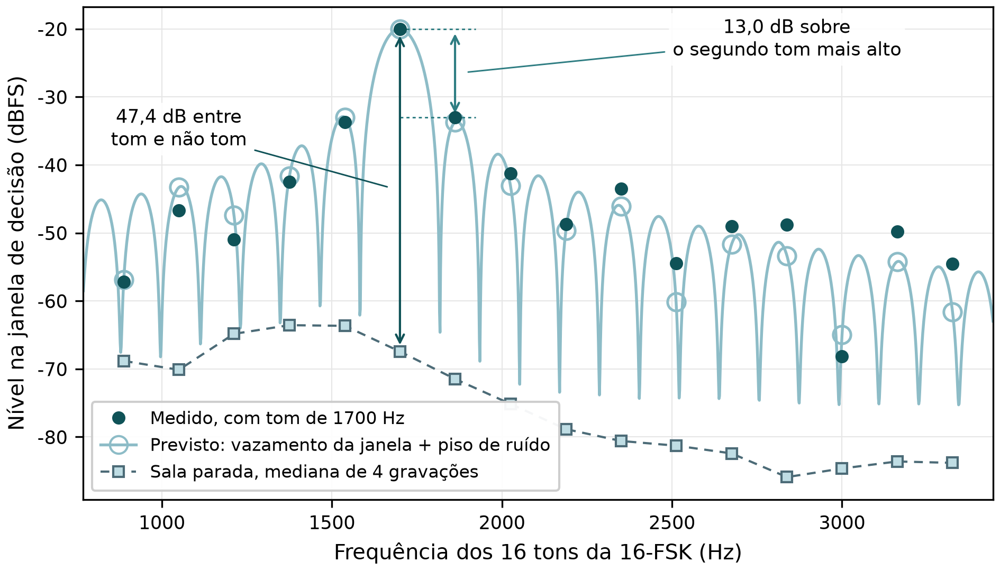
Figura 4 - Energia nos dezesseis tons da 16-FSK na janela de decisão, com o tom de 1700 Hz transmitido. A curva é o previsto por (2) mais o piso de ruído, e os círculos vazados marcam o previsto em cada tom. Os quadrados são a sala em silêncio, mediana de quatro gravações.

Com o tom transmitido, os outros quinze também sobem acima do silêncio, porque recebem os lóbulos laterais do próprio tom. Até 2,5 kHz o medido difere do previsto em 0,9 dB na mediana, e a diferença chega a 3,5 dB nos tons próximos de um zero da curva, onde o nível muda rapidamente com a frequência. Acima de 2,5 kHz o medido fica em mediana 4,5 dB acima do previsto, excesso que o vazamento da janela não explica. O maior desvio, 7,1 dB em 3325 Hz, ocorre a 75 Hz do segundo harmônico de 1700 Hz, assunto da Figura 5.

O detector escolhe o maior dos dezesseis, então o tom transmitido precisa vencer ao mesmo tempo o piso de ruído, por 47,4 dB, e o vazamento sobre o vizinho, por 13,0 dB.

A cadeia analógica acrescenta ainda frequências que não foram transmitidas. Amplificador, alto-falante e microfone não respondem de forma perfeitamente proporcional ao sinal, e toda resposta não linear a um tom produz energia nos múltiplos inteiros da sua frequência, os harmônicos. Por isso um tom emitido sempre chega acompanhado de harmônicos, que crescem com o nível. Em nível alto o cone do alto-falante e o amplificador atingem seus limites e achatam os picos, e a distorção aumenta, e Putz *et al.* (2026) mediram distorção não linear na maioria dos aparelhos acima de cerca de 75% do volume máximo.

A Figura 5 mostra esse efeito entre as duas máquinas do sistema implementado, com uma varredura de 300 a 6000 Hz emitida em seis segundos por uma delas e registrada pelo microfone da outra. Além da fundamental aparecem duas diagonais, o segundo e o terceiro harmônicos, em mediana 30,5 e 42,2 dB abaixo dela. Com os dezesseis tons entre 888 e 3325 Hz, o segundo harmônico de seis deles cai a menos de 76 Hz de outro tom, e o terceiro de dois deles a menos de 12 Hz, somando energia a uma frequência que não foi transmitida.

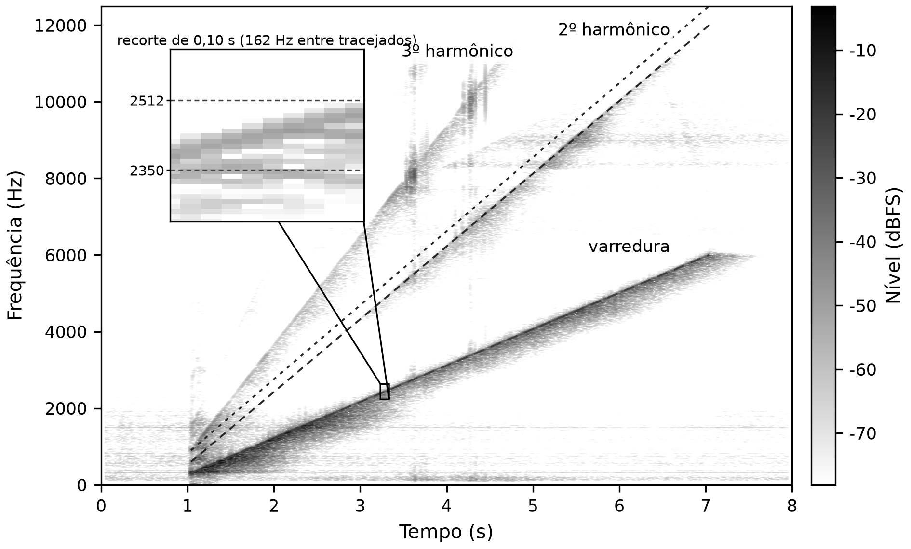
Figura 5 - Varredura de 300 a 6000 Hz, em janela de 4096 amostras. As diagonais são o segundo e o terceiro harmônico, e os riscos verticais são sons da sala.

<!-- Winderson: o caso do microfone mais antigo que entregava sinal espúrio entra aqui se houver registro (qual máquina, o que se viu). Sem registro, fica fora. Transmissão pela carcaça e pela mesa: sem medida no repositório, fora. -->

### 2.3 Limites dos transdutores

Alto-falantes e microfones de uso geral respondem bem na faixa da fala e perdem eficiência nos extremos, e os tons do trabalho ficam entre 700 e 3325 Hz por isso. O ultrassom fica fora. Exigir inaudibilidade deixa uma faixa de menos de 4 kHz, onde o hardware de áudio já é seletivo (PUTZ *et al.*, 2026), e a absorção do ar cresce com a frequência e encurta o alcance.

<!-- Caixa Bluetooth (atraso e compressão do codec) fora até haver número que o artigo use. -->

## 3 CAMADA FÍSICA

A camada física converte os bits a transmitir em tons e, na recepção, converte o som captado de volta em bits, entregando com cada bit a confiança da decisão. Fazem parte dela a forma de transmissão, a decisão de qual tom esteve presente, o sincronismo de símbolo e o nível de operação, apresentados nessa ordem. A correção de erros, a localização do bloco e a montagem de pacotes ficam acima dela, na camada de enlace.

### 3.1 Formas de transmissão

A Figura 6 mostra o que cada forma emite para o mesmo byte, 1011 0010, com as frequências usadas no sistema implementado. Cada traço é um tom soando durante um símbolo, e acima de cada símbolo estão os bits que ele carrega.

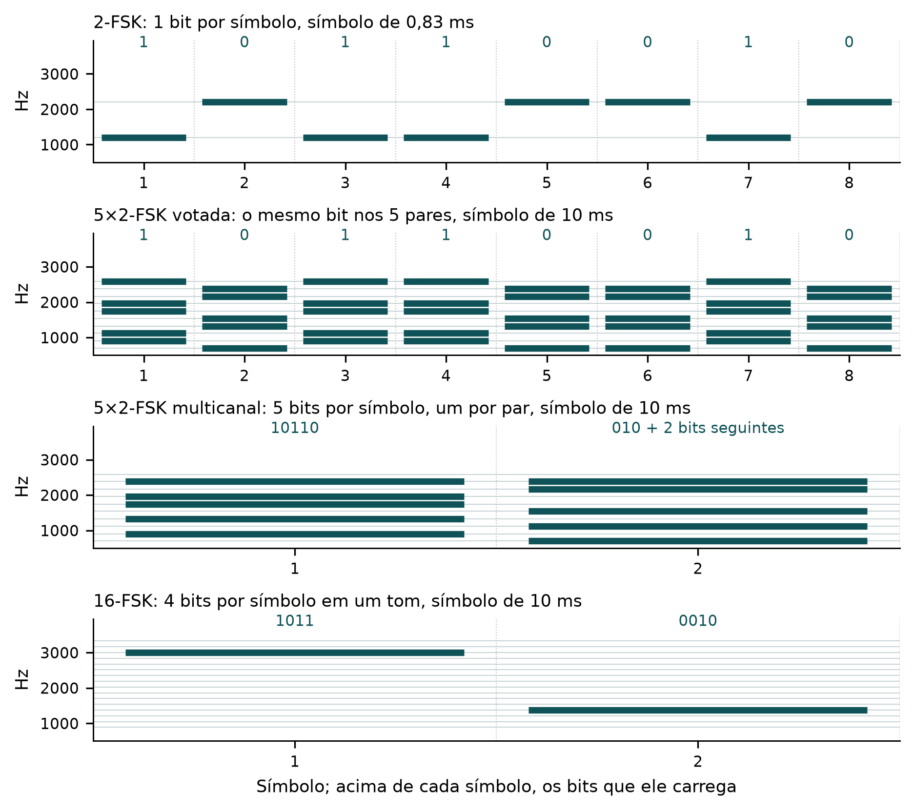
Figura 6 - Tons emitidos por cada forma para o byte 1011 0010. As linhas claras são todas as frequências disponíveis em cada forma, e os traços escuros, as que soam em cada símbolo. A 2-FSK usa símbolos de 0,83 ms, e as demais, de 10 ms.

A 2-FSK usa os dois tons do padrão Bell 202, 1200 e 2200 Hz, a 1200 símbolos por segundo. O receptor multiplica o sinal por uma cópia atrasada de si mesmo, e o sinal do produto filtrado indica qual tom está presente. Essa decisão depende do nível relativo dos dois tons, e um canal que atenue um deles mais que o outro desloca todas as decisões no mesmo sentido.

A 5×2-FSK votada soa cinco pares de tons a cada símbolo, a 100 símbolos por segundo, todos com o mesmo bit. Os dois tons de cada par ficam a 200 Hz um do outro, próximos o bastante para que o canal os trate de modo semelhante, e cada par decide pelo tom que chegou mais forte. A maioria dos cinco pares dá o bit, de modo que um par em um mínimo da resposta em pente perde a votação sem decidir o resultado.

A 5×2-FSK multicanal usa os mesmos cinco pares, mas cada par passa a funcionar como um canal 2-FSK independente. Em vez de repetir o mesmo bit nos cinco pares, o transmissor distribui cinco bits consecutivos dos dados, um por par, e cada símbolo transmite cinco bits ao mesmo tempo. A taxa fica cinco vezes maior, e em troca não há votação, de modo que um par em um mínimo da resposta em pente perde o seu bit.

Como todo tom chega acompanhado de harmônicos (seção 2.2, Figura 5), nas duas formas de cinco pares os dez tons foram escolhidos para que o segundo e o terceiro harmônicos de um tom que representa o valor 0 não caiam sobre um tom que representa o valor 1, nem o contrário. Um harmônico nessa posição somaria energia ao valor errado.

A 16-FSK emite um tom por símbolo, escolhido entre dezesseis frequências de 888 a 3325 Hz espaçadas de cerca de 162 Hz, e carrega quatro bits a 100 símbolos por segundo. Os valores seguem o código Gray, numeração em que tons vizinhos carregam valores que diferem em um único bit, enquanto no binário comum, de 0111 para 1000, mudam os quatro. O erro mais provável é a confusão com o tom vizinho, que recebe o vazamento do tom transmitido (Figura 4), e com o código Gray esse erro custa um bit, e não até quatro.

As formas diferem também na potência por tom. Nas de cinco pares, cinco tons dividem o mesmo pico de amplitude, e cada tom sai cerca de 14 dB abaixo do que sairia sozinho. Na 16-FSK um único tom recebe toda a amplitude disponível.

### 3.2 Decisão contra o piso

Pelo que se viu na seção 2.2, cada tom deve ser comparado com o piso de ruído na sua própria frequência. Na 16-FSK o receptor mede a energia de cada tom na janela, divide-a pelo piso corrente daquela frequência e escolhe o maior, conforme (3).

$$\hat{k} = \arg\max_k \frac{E_k}{P_k} \tag{3}$$

Nela, $E_k$ é a energia no tom $k$ e $P_k$ é a média corrente dessa energia, atualizada a cada símbolo sem o tom que venceu. Como cada tom fica em silêncio em quinze de cada dezesseis símbolos, essa média estima o piso de ruído naquela frequência sem ser contaminada pelo sinal.

A Figura 7 mostra essa decisão em um símbolo recebido no sistema implementado. Em cima estão o espectro da janela e o piso corrente de cada tom, e embaixo a energia de cada tom dividida pelo seu piso, que é a grandeza comparada em (3). O tom transmitido fica 8,0 dB acima do segundo colocado, contra uma mediana de 7,9 dB ao longo do bloco.

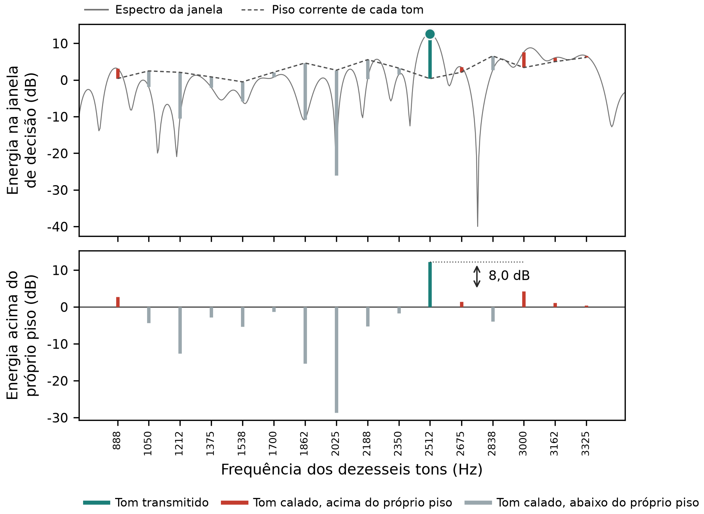
Figura 7 - Decisão da 16-FSK em um símbolo. Em cima, o espectro da janela e o piso corrente de cada tom. Embaixo, a energia de cada tom acima do próprio piso, que é o que o receptor compara.

O receptor não entrega apenas o valor decidido. Para cada bit do símbolo, ele compara o melhor tom em que o bit vale 1 com o melhor em que vale 0, e a diferença entre os dois, em logaritmo, é a confiança da decisão, chamada verossimilhança logarítmica, do inglês *log-likelihood ratio* (LLR). A camada de enlace usa essa confiança na correção de erros.

### 3.3 Sincronismo de símbolo

As duas máquinas não compartilham relógio, e o receptor precisa estimar onde cada símbolo começa. A primeira solução é uma malha de adiantamento e atraso, que a cada símbolo mede três janelas deslocadas de um oitavo de símbolo e corrige o instante do símbolo seguinte na direção da janela mais nítida. A malha só se ajusta em transições de tom, e por isso a transmissão começa com um preâmbulo de tons alternados.

A malha acompanha bem a média, mas pode perder o alinhamento no meio de um quadro e levar consigo todos os símbolos seguintes. A segunda solução marca o quadro por fora, com uma varredura de frequência de 80 ms em cada extremidade. O receptor localiza as duas varreduras por correlação com a varredura conhecida, e a primeira dá o início do quadro.

A distância entre as duas varreduras dá também o período real do símbolo, conforme (4).

$$T = \frac{n_2 - n_1}{S} \tag{4}$$

Nela, $n_1$ e $n_2$ são as posições das duas varreduras, em amostras, e $S$ é o número de símbolos entre elas.

A Figura 8 ilustra o quadro no formato do visor apresentado na seção 5, com a frequência no eixo horizontal e o tempo no vertical. É um quadro curto, de 30 símbolos, gerado pelo modulador do sistema sem passar pelo ar, para que cada símbolo fique visível. O receptor localiza as duas varreduras, marca $n_1$ no fim da primeira e $n_2$ no início da segunda, e divide o intervalo pelos $S$ símbolos entre elas, o que dá as fronteiras de símbolo desenhadas.

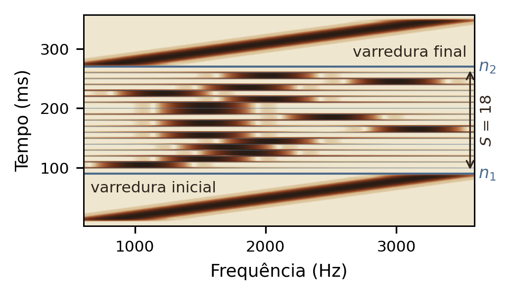
Figura 8 - Quadro curto de 16-FSK entre as duas varreduras de sincronismo, gerado pelo modulador do sistema, no formato do visor, com o mais recente no alto. As linhas finas são as fronteiras de símbolo obtidas por (4).

No sistema implementado, em quatro quadros de 2453 símbolos recebidos entre as duas máquinas, o período medido por (4) variou de 479,90 a 480,07 amostras, contra 480 nominais. Uma diferença de 0,1 amostra por símbolo acumula cerca de 245 amostras ao longo do quadro, metade de um símbolo e mais do que as 72 do intervalo de descarte, e o fim do quadro seria lido com a janela fora do símbolo se o período nominal fosse usado.

O mesmo cálculo mostra por que $S$ tem de ser exato. Um símbolo a mais ou a menos na contagem erra o período em 480/2453 ≈ 0,2 amostra, e o erro acumulado ao longo do quadro chega a um símbolo inteiro.

### 3.4 Nível de operação

A seção 2.2 mostrou que, acima de certo nível, a cadeia analógica achata os picos e gera harmônicos. O volume do alto-falante e o ganho de captura são, por isso, ajustados abaixo desse ponto, e esse ajuste é condição de todos os ensaios. Na 16-FSK, a troca abrupta de tom a cada símbolo produz picos cerca de 2,5 vezes maiores que os de um tom contínuo, medidos no sistema implementado, e o nível é calibrado com uma transmissão real e não com um tom isolado.

<!-- Pendente: confirmar com o autor se a 2-FSK da Tabela 1 é a de Bell 202 (1200/2200 Hz, 1200 baud, sem correção de erros) ou a 2-FSK justa de 1700/2350 Hz a 100 baud com FEC (fsk2 no código). O texto acima descreve a de Bell 202, como a primeira versão. Gray: o código foi corrigido em 2026-10-29 (valor = gray(tom)); a Tabela 1 precisa ser medida já com essa versão. -->

## 4 CAMADA DE ENLACE

A camada de enlace recebe da camada física os bits com a sua confiança e entrega à aplicação os dados íntegros e na ordem em que foram enviados. Fazem parte dela a correção de erros, a localização do bloco no fluxo recebido, a divisão dos dados em pacotes com retransmissão e a negociação do enlace pelo próprio som.

### 4.1 Correção de erros

Mesmo com o nível ajustado, parte dos bits chega trocada, e a camada de enlace precisa corrigi-los sem pedir a transmissão de novo. Para isso o transmissor envia mais bits do que a mensagem tem, e o excesso, chamado redundância, é o que permite ao receptor descobrir e desfazer as trocas.

A forma mais simples de redundância é enviar cada bit três vezes e decidir pela maioria. Um bit trocado entre as três cópias é corrigido, mas cada cópia só confere o próprio bit. Se duas cópias do mesmo bit chegarem trocadas, a maioria decide errado, ainda que todos os vizinhos tenham chegado certos, e um único bit errado basta para que o pacote inteiro falhe na verificação e seja descartado.

Para evitar essa fragilidade, o sistema usa um código convolucional. Ele também envia três bits por bit da mensagem, mas nenhum deles é cópia. Cada bit enviado é o resultado de uma operação lógica entre o bit que entra e alguns dos que vieram antes dele, e por isso confere vários bits da mensagem de uma vez. Os bits da mensagem passam a guardar informação uns sobre os outros, e um bit trocado no ar pode ser reconstituído pelos demais bits enviados que também dependem dele.

A operação é o ou-exclusivo, que dá 1 quando a quantidade de uns é ímpar e 0 quando é par. A Figura 9 mostra o cálculo com um exemplo. O codificador guarda em fila os sete últimos bits da mensagem, e cada um dos três bits enviados é o ou-exclusivo de um grupo diferente desses sete. Quando o bit seguinte entra, a fila anda uma posição e o cálculo se repete, de modo que cada bit da mensagem participa de sete cálculos seguidos.

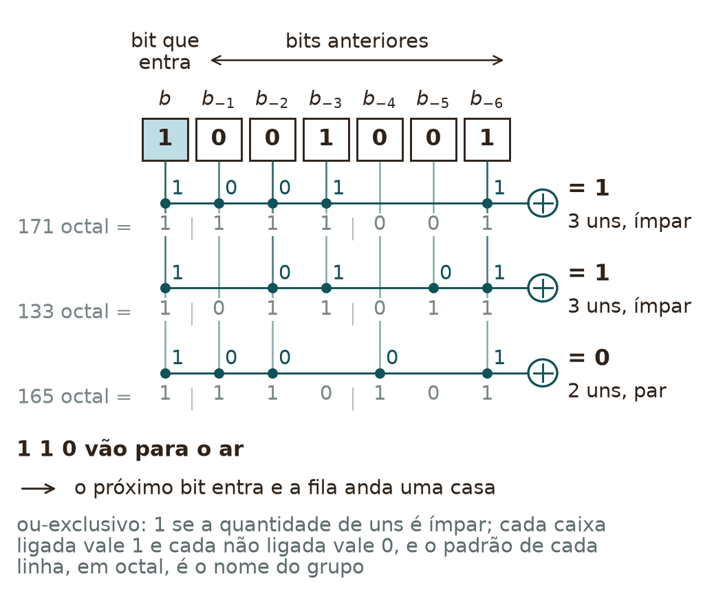
Figura 9 - Codificador convolucional com um exemplo. A fila guarda os sete últimos bits da mensagem, e cada bit enviado é o ou-exclusivo dos bits marcados na sua linha. Ao lado de cada linha, o seu padrão de ligações, com 1 para caixa ligada, e o mesmo padrão em octal.

Na nomenclatura da literatura, o código usado tem taxa um terço, três bits enviados por bit da mensagem, e comprimento de restrição sete, os sete bits que entram em cada cálculo (PROAKIS; SALEHI, 2008). Cada grupo é identificado pelo seu padrão de ligações. Lida a linha da Figura 9 do bit que entra ao mais antigo, cada caixa ligada vale 1 e cada uma não ligada vale 0. A primeira linha dá 1111001, que em octal, de três em três bits, se escreve 171, e as outras duas dão 133 e 165.

Na recepção, o decodificador procura a mensagem cuja codificação mais se parece com o que chegou, pelo algoritmo de Viterbi (VITERBI, 1967). Como cada bit da mensagem entra no cálculo de vários bits enviados, uma mensagem errada discorda do recebido em muitas posições, e a certa, só nas poucas que chegaram trocadas. Cada discordância pesa conforme a confiança com que o bit chegou, o que se chama decisão suave, e um bit trocado que chegou com baixa confiança quase não pesa. A combinação de código convolucional e decodificação de Viterbi se firmou nos enlaces de comunicação espacial, em que o canal também entrega bits ruidosos e o decodificador alcança desempenho próximo do ótimo com complexidade modesta (FORNEY, 1973).

A Figura 10 mostra essa correção em um bloco recebido no sistema implementado. Dos 1170 bits codificados, 112 chegaram errados, 9,6%, e a mensagem decodificada saiu sem nenhum erro. Embaixo, a figura mostra por quê: 107 dos 112 bits errados chegaram com confiança baixa, abaixo de 1,7, contra 273 dos 1058 certos, e por isso pesaram pouco na correção.

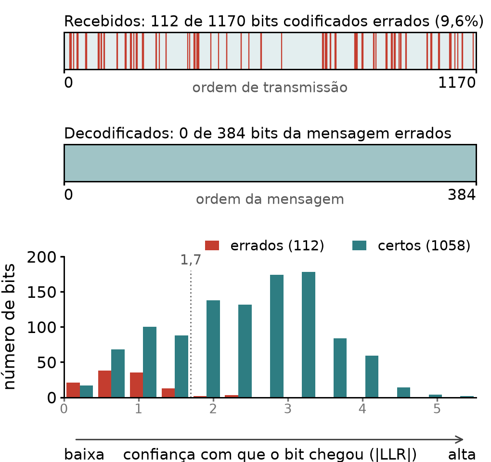
Figura 10 - Correção de um bloco de 48 bytes recebido em 16-FSK. Em cima, a posição dos bits codificados errados, na ordem de transmissão; no meio, a mensagem decodificada, sem erros; embaixo, quantos bits errados e certos chegaram em cada faixa de confiança.

Antes de transmitidos, os bits codificados são entrelaçados, escritos em linhas e lidos em colunas, o que afasta no tempo bits que o código mantém próximos. Uma perturbação curta, como um ruído de rajada, atinge então bits espalhados, que o decodificador corrige um a um. O bloco pode ainda ser repetido, o que aumenta a tolerância a erros à custa de tempo de transmissão.

### 4.2 Localização do bloco

A camada física entrega ao receptor uma sequência longa de bits, com o preâmbulo, o bloco e o que veio antes e depois deles, sem nenhuma indicação de qual é o primeiro bit do bloco. Começar a decodificação um único bit adiantado ou atrasado basta para que o decodificador da seção 4.1 entregue uma mensagem errada.

Contar os bits desde o início da transmissão não resolve. A malha de sincronismo da seção 3.3 pode ganhar ou perder um símbolo ao longo do preâmbulo, e na 16-FSK cada símbolo vale quatro bits.

Para marcar o início, o transmissor coloca logo antes do bloco uma palavra de referência, uma sequência fixa de 31 bits conhecida pelas duas pontas. O receptor desliza essa palavra ao longo dos bits recebidos e, em cada posição, compara os 31 bits com os que chegaram. Fora da palavra, as coincidências ficam em torno da metade, como num sorteio, e na posição da palavra quase todos os bits coincidem. Essa operação se chama correlação, e o bloco começa no bit seguinte ao da maior coincidência.

A Figura 11 mostra onde a palavra fica no quadro transmitido, entre o preâmbulo e o bloco codificado, que ocupa a maior parte do tempo no ar.

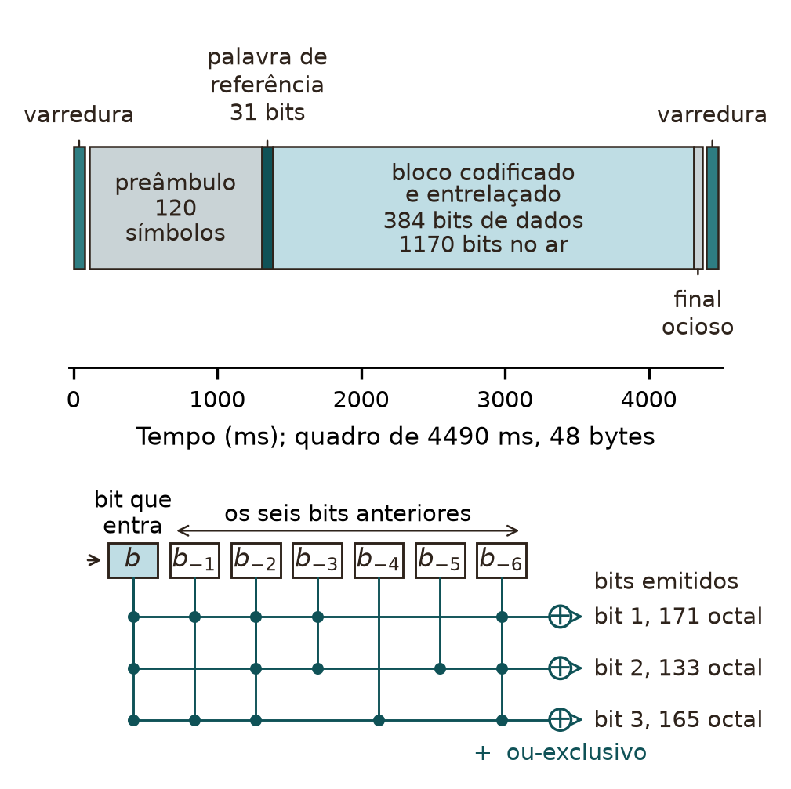
Figura 11 - Quadro de 48 bytes em 16-FSK, em escala de tempo, entre as duas varreduras de sincronismo da seção 3.3.

### 4.3 Pacotes e retransmissão

Para transferir um arquivo, os dados são divididos em pacotes, cada um com número de sequência, comprimento e verificação de redundância cíclica, do inglês *cyclic redundancy check* (CRC), de 16 bits. O receptor pede um pacote, confere o CRC e só então pede o seguinte, repetindo o pedido até quatro vezes enquanto a verificação falhar. É o arranjo pare-e-espere dos protocolos de enlace (TANENBAUM; WETHERALL, 2011). Ao fim, um CRC de 32 bits sobre o arquivo inteiro confirma o resultado.

A retransmissão só converge se a maioria dos pacotes chegar íntegra na primeira tentativa. Por isso ela complementa a correção de erros, e não a substitui.

### 4.4 Negociação do enlace pelo ar

A qualidade de cada tom não é fixa. No sistema implementado, os três piores tons concentraram de 47% a 90% dos erros de símbolo em cada sessão, e esses tons mudaram de uma sessão para outra (Figura 12). Uma configuração escolhida de antemão serve, portanto, a uma sessão e não à seguinte.

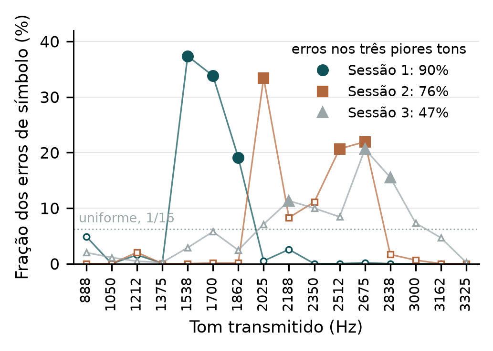
Figura 12 - Fração dos erros de símbolo em cada tom da 16-FSK, em três sessões no mesmo sentido. Os marcadores cheios são os três piores tons de cada sessão, e a linha pontilhada, a fração de uma distribuição uniforme.

Na negociação, as duas estações configuram o enlace pelo próprio som, sem canal auxiliar. A estação que chama emite um par de varreduras de frequência, e a que escuta responde. Em seguida cada uma sonda o canal no sentido em que transmite, com tons isolados em todas as frequências candidatas e blocos conhecidos em níveis crescentes.

Quem decide a configuração de cada sentido é o receptor, que é quem mediu a sondagem. Ele escolhe os tons utilizáveis, o nível de transmissão e a taxa, e envia essa escolha como um contrato. Os dados seguem em pare-e-espere, e se os pacotes falharem repetidamente o transmissor recua para uma taxa menor.

A Figura 13 mostra a sequência em uma sessão do sistema implementado, da chamada aos dados, com um pacote ilegível pedido de novo e retransmitido.

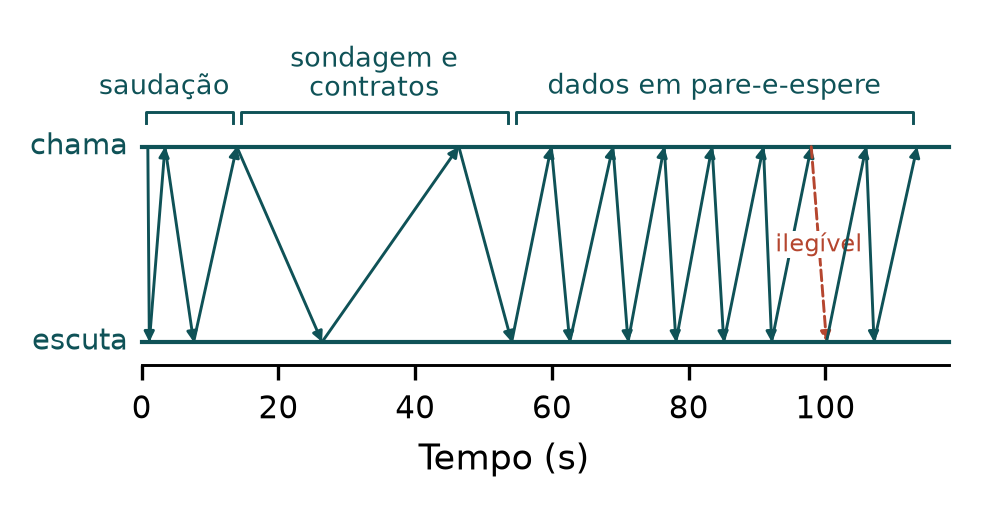
Figura 13 - Sequência de uma sessão negociada pelo ar, em escala de tempo. Cada seta vai do fim da leitura de um turno ao fim da leitura do seguinte. A seta tracejada é um pacote ilegível.

## 5 INTERFACE COM A APLICAÇÃO

O enlace negociado é operado por uma tela no navegador, o visor, executada em cada máquina ao lado da sessão daquela máquina. O visor inicia a sessão, mostra o estado do enlace enquanto ela transcorre e apresenta os dados recebidos ao final.

A tela reúne o necessário para acompanhar uma sessão sem consultar registros. O espectrograma do microfone, com o mais recente no alto, mostra os sinais que chegam, e a escala de frequência acima dele marca os tons contratados em cada sentido. Um fluxograma do aperto de mão indica a etapa atual da negociação, da chamada ao contrato e aos dados, e contadores e listas registram os últimos sinais enviados e ouvidos e as decisões tomadas.

Sobre o mesmo enlace estão em implementação uma conversa, em que o canal permanece aberto entre as mensagens, e um terminal de comandos.

<!-- Chat e terminal: descrever quando estiverem prontos (outra sessão). Figura do visor em modo projeção (claro) com as fases chamada, sondagem, contrato e dados: capturar quando o áudio e o painel estiverem livres; pode ficar no capítulo 6.5. Porta serial virtual: hoje só app.py --pty, sobre a 2-FSK de Bell 202 sem correção de erros, que não entregou mensagem pelo ar; o enlace negociado não expõe porta serial. O resumo e a introdução afirmam a porta serial virtual: rever. -->

## 6 RESULTADOS EXPERIMENTAIS

### 6.1 Bancada

Dois computadores na mesma sala, cada um com alto-falante e microfone de uso geral. Um canal de controle entre eles apenas comanda o ensaio, e os bytes avaliados viajam somente pelo ar. Foram usadas duas montagens, uma com o alto-falante a 10 cm do microfone e outra com ele afastado, ambas com o nível abaixo da saturação.

### 6.2 Formas de transmissão

A Figura 14 mostra as formas de transmissão na bancada a 10 cm, com blocos de 48 bytes e ganho 0,5.

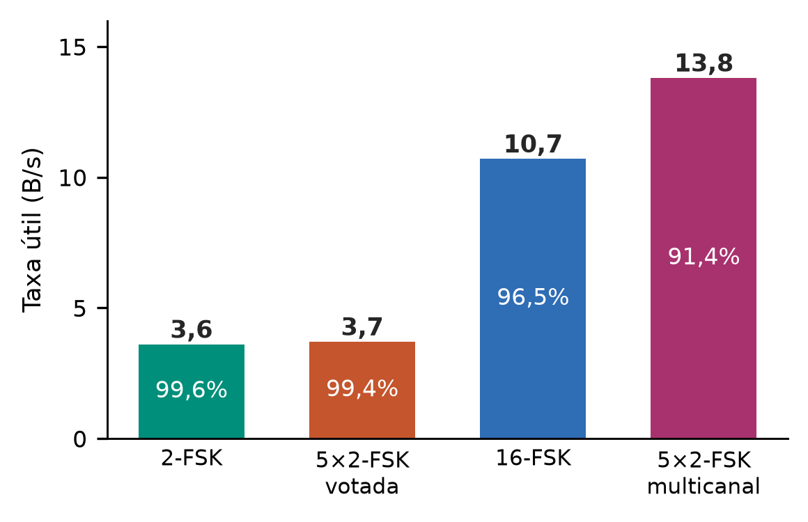
Figura 14 - Bits certos em cada gravação, por forma de transmissão, a 10 cm. Círculo cheio, bloco entregue íntegro; vazio, bloco perdido. À direita, blocos íntegros e taxa útil calculada pela duração do quadro.

A 2-FSK de Bell 202, sem correção de erros, não entrega nenhum bloco. Com correção de erros, todas as formas entregam a maior parte dos blocos. A 5×2-FSK multicanal tem a maior taxa, 13,8 B/s, com o menor acerto de bits, e a 16-FSK só entrega todos os blocos com as varreduras de sincronismo.

Com o alto-falante afastado, a 16-FSK entregou 4 blocos de 4 a 11,3 B/s, com 5,9% a 9,5% dos bits codificados trocados, todos corrigidos.

<!-- Fontes: F01-2FSK-10CM, H03-2FSK-FEC (2-FSK com correção, 4 gravações), F02, F03, F00-NIVEL-10CM, F04-16FSK-10CM (2026-10-08); 14-FEC-REP (2026-09-03; rep 2 e 4 também 4/4, a 6,7 e 3,7 B/s). Taxas calculadas pelo código (RESUMO-CAMPANHA-FINAL.md). Gravações com o mapeamento Gray anterior à correção de 2026-10-29. Script: resultados/FIG-RESULTADOS/. -->

### 6.3 Sincronismo

A Figura 15 compara a malha de adiantamento e atraso com as varreduras, lidas sobre as mesmas gravações.

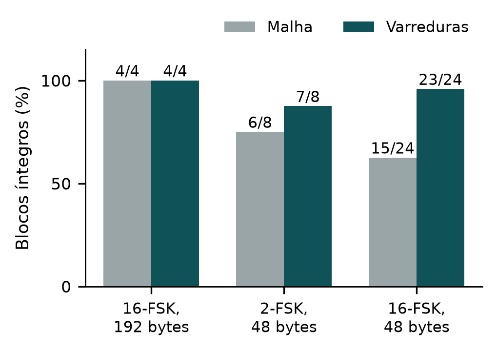
Figura 15 - Blocos íntegros com a malha e com as varreduras, nas mesmas gravações, em três conjuntos.

Quando a malha acompanha o sinal, as duas empatam. A diferença está nos quadros em que a malha perde o alinhamento, que as varreduras recuperam, e é maior no conjunto gravado por um só computador, que toca e grava ao mesmo tempo, em que as varreduras leram mais bits que a malha em 23 das 24 gravações.

<!-- Fontes: 12-13-SYNC (4 gravações, 192 B, rep 2), H03-2FSK-FEC (as 8 com varreduras), studies/20260903-111105-ganho-mary (uma máquina, ganho 0,20 a 0,38). -->

### 6.4 Transferência de arquivo

Uma imagem de 1334 bytes foi transferida com o alto-falante afastado e chegou idêntica, conferida pelo CRC de 32 bits (Figura 16). Em pacotes de 64 bytes, os 21 pacotes chegaram sem retransmissão, a 6,8 B/s, e em pacotes de 128 bytes, os 11 chegaram com 3 retransmissões, a 7,2 B/s.

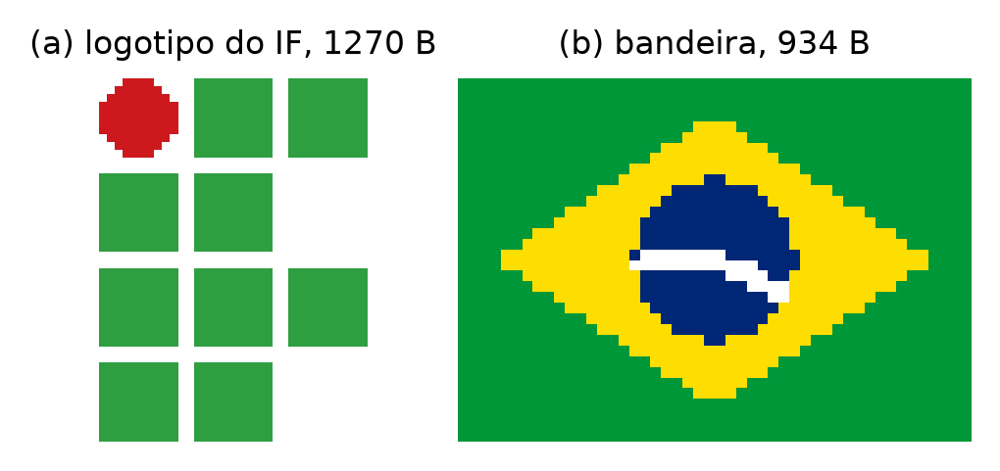
Figura 16 - Imagem de 1334 bytes enviada (a) e recebida pelo ar (b), idênticas byte a byte.

A taxa fica abaixo da do bloco isolado pelo preâmbulo, pelo cabeçalho e pela espera entre pacotes. A 10 cm, três transferências da mesma imagem também chegaram idênticas, de 5,0 a 7,6 B/s.

### 6.5 Enlace negociado

Com as máquinas a cerca de 2 m e sem configuração prévia, cada sessão válida entregou completos os 207 bytes de um sentido e os 44 do outro, em 302 s com a negociação automática. Os contratos dos dois sentidos excluíram tons diferentes e fixaram ganhos diferentes, o que confirma a medida por sentido. Com outro computador em uma das pontas, a sessão também se completou, em 405 s.

<!-- Fontes: H07-ENLACE-MODOS (2026-10-22), H06-ENLACE-AR sessão 3 (contratos: A->B exclui 4 tons, ganho 0,45, rep 2; B->A exclui 3, ganho 0,3, rep 1), sessoes-enlace-2maq/20261027-175531 (405 s). Figura do visor em modo projeção com as fases: a capturar. 6.6 chat e terminal: quando medidos. -->

## 7 CONSIDERAÇÕES FINAIS

<!-- Roteiro, capítulo 7. Por redigir por último. -->

## DECLARAÇÃO DE USO DE INTELIGÊNCIA ARTIFICIAL GENERATIVA

Em conformidade com a Portaria CNPq nº 2.664/2026, os autores declaram o uso de Claude-Code (Anthropic) e Codex (OpenAI) na concepção, para discussão da abordagem e levantamento de referências, na implementação e na análise, para redação e depuração do software do modem e dos scripts de ensaio, e na redação do texto, para clareza e correção de linguagem. Todo o conteúdo gerado foi verificado e editado pelos autores, que assumem responsabilidade integral pelo trabalho.

<!-- A primeira versão dizia "firmware"; o projeto não tem firmware, trocado por "software do modem". -->

## CONFLITO DE INTERESSES

Os autores declaram não haver conflito de interesses no desenvolvimento e na publicação deste trabalho.

## REFERÊNCIAS

FINNEGAN, Kenneth W.; BENSON, Bridget. Clarifying the amateur Bell 202 modem. In: **ARRL/TAPR Digital Communications Conference (DCC)**, 33., 2014. Anais [...]. [S.l.]: TAPR, 2014.

FORNEY JR., G. David. The Viterbi algorithm. **Proceedings of the IEEE**, v. 61, n. 3, p. 268-278, mar. 1973.

GERGANOV, Georgi. **ggwave**: tiny data-over-sound library. 2021. Disponível em: https://github.com/ggerganov/ggwave.

KUTTRUFF, Heinrich. **Room acoustics**. 6. ed. Boca Raton: CRC Press, 2016.

LOPES, Cristina Videira; AGUIAR, Pedro M. Q. Aerial acoustic communications. In: **IEEE Workshop on Applications of Signal Processing to Audio and Acoustics (WASPAA)**, 2001, New Paltz. Anais [...]. New Paltz: IEEE, 2001.

LOPES, Cristina Videira; AGUIAR, Pedro M. Q. Acoustic modems for ubiquitous computing. **IEEE Pervasive Computing**, v. 2, n. 3, p. 62-71, 2003. DOI: 10.1109/MPRV.2003.1228528.

PROAKIS, John G.; SALEHI, Masoud. **Digital communications**. 5. ed. Nova York: McGraw-Hill, 2008.

PUTZ, Florentin; FORTMANN, Philipp; FRANK, Jan; HAUGWITZ, Christoph; KUPNIK, Mario; HOLLICK, Matthias. Evaluating acoustic data transmission schemes for ad-hoc communication between nearby smart devices. **ACM Transactions on Internet of Things**, v. 7, n. 1, art. 8, 2026. arXiv:2602.02249.

TANENBAUM, Andrew S.; WETHERALL, David J. **Computer networks**. 5. ed. Boston: Pearson, 2011.

VITERBI, Andrew J. Error bounds for convolutional codes and an asymptotically optimum decoding algorithm. **IEEE Transactions on Information Theory**, v. IT-13, n. 2, p. 260-269, abr. 1967.

WU, Joseph. **A basic guide to the HART protocol**. Dallas: Texas Instruments, nov. 2023. (Application Report SLAAEH0). Disponível em: https://www.ti.com/lit/pdf/slaaeh0.

<!-- KUTTRUFF, PROAKIS, TANENBAUM e VITERBI ficam se os capítulos 2 a 4 os citarem; retirar os que sobrarem sem citação. -->
